<picture>
  <source media="(prefers-color-scheme: light)" srcset="assets/banner-light.svg">
  
</picture>

Diseño y construyo aplicaciones web y móviles, desde la API hasta el último píxel. Estudio Ingeniería de Software en ISIL (Lima, Perú) y busco prácticas en desarrollo.

**[Ver mi portafolio](https://portafolio-teal-pi.vercel.app)** · **[LinkedIn](https://www.linkedin.com/in/ernesto-veramendi)**

### Proyectos destacados

| Proyecto | Qué es | Stack |
|---|---|---|
| [Restaurante POS](https://github.com/Gaen17/Restaurante-POS) | Punto de venta: app Android conectada en tiempo real a una API REST | Java, Android, PHP, MySQL |
| [Aventura Matemática](https://github.com/Gaen17/aventura-matematica) | Práctica de matemáticas interactiva para tercer grado de primaria | JavaScript, Tailwind CSS, Chart.js |
| [Portafolio](https://github.com/Gaen17/Portafolio) | Escritorio tipo Linux en el navegador, con cuatro temas y vista directa | React, TypeScript, Vite, Vercel |

### Con qué trabajo

<picture>
  <source media="(prefers-color-scheme: light)" srcset="https://skillicons.dev/icons?i=ts,js,react,nodejs,vite,java,kotlin,androidstudio,py,php,mysql,html,css,git,vercel&perline=8&theme=light">
  
</picture>

¿Tienes un proyecto o una vacante? Escríbeme desde el [formulario de contacto del portafolio](https://portafolio-teal-pi.vercel.app/#contacto).
